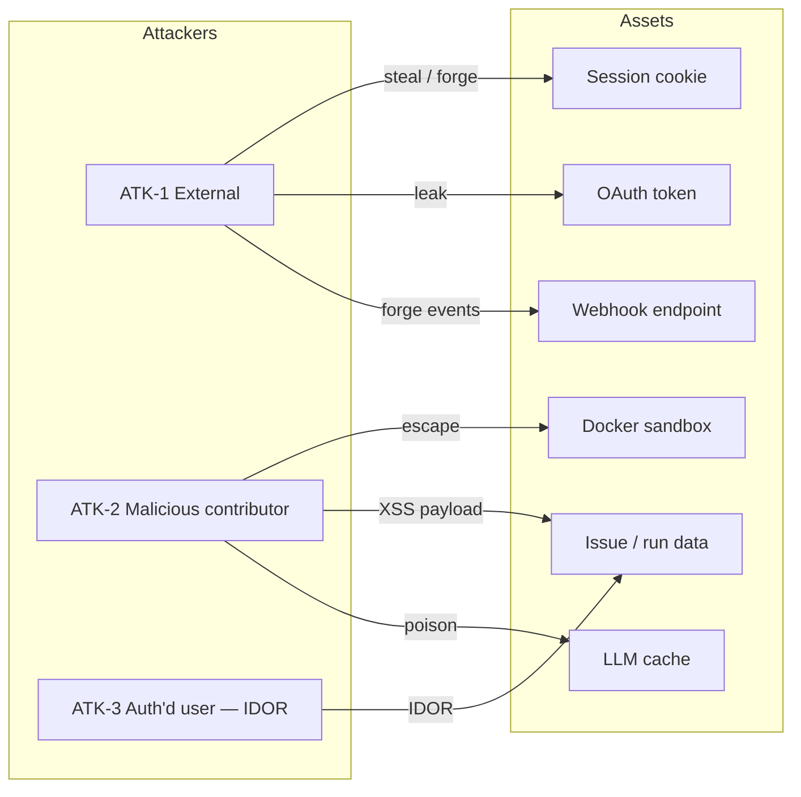

# 07 — Security & Privacy: Bug-Fix Agent

Plain English first, code second. Every control maps to an OWASP Top 10 2021 category and a STANDARDS.md launch-gate checkbox.

---

## 1 · Threat model

### 1.1 Assets

| # | Asset | Why it matters |
|---|-------|---------------|
| A1 | **Session cookies** | Identify the authenticated user; theft = account takeover |
| A2 | **GitHub OAuth access tokens** | Encrypted in `sessions.token`; leakage = repo read/write on behalf of the user |
| A3 | **Issue / PR content** snapshotted into `runs` | `issue_title`, `issue_body`, `test_output`, `root_cause` — may contain customer-sensitive bug details |
| A4 | **Docker sandbox** | Untrusted repo code is cloned, installed, and tested here; escape = host compromise |
| A5 | **LLM cache** | Cached responses keyed by issue hash; poisoning = wrong fixes served to future runs |
| A6 | **Webhook endpoint** | Receives `agent-fix` label events; forgery = arbitrary pipeline executions |

### 1.2 Attackers

| # | Profile | Motivation |
|---|---------|-----------|
| ATK-1 | **External attacker** | Steal sessions, forge webhooks, escape sandbox, abuse LLM credits |
| ATK-2 | **Malicious repo contributor** | Push repo code or craft issue content that exfiltrates data, poisons the pipeline, or escapes the sandbox |
| ATK-3 | **Authenticated user (IDOR)** | Read or modify another user's or another org's runs by guessing `run_id` |

### 1.3 Top threats and mitigations

| Asset | Threat | Attacker | Mitigation | OWASP 2021 |
|-------|--------|----------|------------|------------|
| Session cookie (A1) | Theft via XSS → session hijack | ATK-1 | `HttpOnly`, `Secure`, `SameSite=Lax`, `__Host-` prefix, 24 h absolute expiry | **A07** Identification & Auth Failures |
| GitHub OAuth token (A2) | Leakage → repo access abuse | ATK-1 | Server-only, AES-256-GCM at rest, never logged, revoked on GitHub App uninstall | **A02** Cryptographic Failures |
| Other users' runs (A3) | IDOR via guessed `run_id` | ATK-3 | Deny-by-default ownership check on every query (`installation_id` + `triggered_by`) | **A01** Broken Access Control |
| Docker sandbox (A4) | Container escape, secret leakage, crypto mining | ATK-2 | Non-root user, no network after dep install, CPU / memory / time limits, no host mounts, no tokens inside container | **A10** SSRF + **A03** Injection |
| Issue / PR content rendered in dashboard (A3) | XSS via malicious issue body or test output | ATK-2 | Output encoding (React text content, no `dangerouslySetInnerHTML`) | **A03** Injection |
| Webhook endpoint (A6) | Forged `agent-fix` events, replay attacks | ATK-1 | `X-Hub-Signature-256` HMAC-SHA256 verification, `X-GitHub-Delivery` dedup | **A08** Software & Data Integrity |
| LLM cache (A5) | Cache poisoning via crafted issue text | ATK-2 | Cache key = SHA-256 of `issue_title + issue_body`; no user-controlled key structure | **A08** Software & Data Integrity |
| Dependency chain | Vulnerable transitive dep → RCE | ATK-1 | Pinned versions, `pip audit` + `npm audit` in CI, zero High / Critical | **A06** Vulnerable & Outdated Components |
| Logs / errors | PII leakage (issue text, tokens) in log output | ATK-1 | Error table (§ 11) — PII never logged; generic user-facing messages | **A09** Security Logging & Monitoring Failures |



---

## 2 · Auth and session design

### 2.1 Provider

**GitHub App OAuth** (PRD-specified). No passwords, no email collection, no PII beyond `github_login` and `github_user_id`. MFA is delegated to GitHub — the app does not implement its own second factor, which is appropriate for a hackathon MVP at ₹0 budget.

OWASP: **A07** Identification & Authentication Failures.

### 2.2 Session cookie (`__Host-session_id`)

| Flag | Value | Why |
|------|-------|-----|
| Name prefix | `__Host-` | Bound to exact host; cannot be overwritten by subdomain cookies |
| `HttpOnly` | `true` | Not readable by JavaScript — blocks XSS-based theft |
| `Secure` | `true` | Only sent over HTTPS |
| `SameSite` | `Lax` | Blocks CSRF on cross-site POST requests |
| `Path` | `/` | Available on all routes |
| `Max-Age` | `86400` (24 h) | Absolute expiry — no sliding window |
| `Domain` | *(omitted)* | With `__Host-` prefix, domain must not be set |

### 2.3 Session lifecycle

```
1. User clicks "Sign in with GitHub"
      → GET /auth/github → 302 to GitHub OAuth consent screen
         (state = CSRF token, stored in short-lived cookie)

2. GitHub consent
      → 302 to /auth/callback?code=xxx&state=yyy

3. Server exchanges code for access token
      → verifies state matches CSRF cookie
      → creates session row (id, github_user_id, github_login, encrypted token, expires_at)
      → sets __Host-session_id cookie
      → 302 to /dashboard

4. Subsequent requests
      → middleware reads cookie → looks up session → verifies not expired
      → invalid / missing → 302 to /auth/github

5. Sign out
      → POST /auth/logout → deletes session row → clears cookie → 302 to /
```

### 2.4 Session rules

- **Expiry**: 24 h absolute. No sliding window — simpler and safer for a short-lived demo.
- **Rotation**: A new `session.id` (UUID v4) is generated on every login. The previous session (if any) for the same `github_user_id` is deleted before inserting the new one — one active session per user.
- **Token storage**: The GitHub access token is encrypted with AES-256-GCM using `SESSION_SECRET` before writing to `sessions.token`.
- **Logout**: Deletes the session row, clears the cookie, and (future) revokes the GitHub OAuth token via the GitHub API.
- **No MFA of our own**: GitHub enforces 2FA / passkeys for users who have enabled it; we inherit that strength.

### 2.5 FastAPI middleware (pseudocode)

```python
# apps/api/auth/middleware.py

async def require_auth(request: Request) -> Session:
    """
    Deny-by-default: if any check fails, raise 401 immediately.
    """
    cookie = request.cookies.get("__Host-session_id")
    if not cookie:
        raise HTTPException(401, detail={"code": "UNAUTHORIZED"})

    session = session_repo.get_by_id(cookie)

    if session is None:
        raise HTTPException(401, detail={"code": "UNAUTHORIZED"})

    if session.expires_at < utcnow():
        session_repo.delete(session.id)
        raise HTTPException(401, detail={"code": "UNAUTHORIZED"})

    return session
```

---

## 3 · Roles × permissions matrix

| Role | View own runs | View other users' runs | Trigger run (label issue) | Retry own run | Delete own data | Manage sessions |
|------|:---:|:---:|:---:|:---:|:---:|:---:|
| **Authenticated user** | ✅ own installation + repo | ❌ | ✅ via `agent-fix` label on repos where App is installed | ✅ if `failed` or `could_not_reproduce` | ✅ (delete-my-data, § 15) | Own session only |
| **Pipeline (service)** | — | — | — | — | — | Writes runs directly; no user session |
| **Unauthenticated visitor** | ❌ | ❌ | ❌ | ❌ | ❌ | ❌ |

- There is **no admin role** in v1.
- The pipeline is a server-side process that writes to the data store directly; it does not go through the HTTP API.
- All permissions default to **deny**. Explicit allow is granted only for the cells marked ✅.

OWASP: **A01** Broken Access Control.

---

## 4 · Deny-by-default access policies

### 4.1 Why not SQL RLS

Per ADR-006 (`05-architecture.md`), v1 uses no database — run logs are transient JSON files / in-memory behind a repository interface. Ownership checks are enforced in the Python repository layer, not via PostgreSQL Row-Level Security.

### 4.2 Ownership check per query

Every query starts from `triggered_by == caller AND installation_id == caller's installation`. No query ever accepts a bare `run_id` without an ownership guard.

```python
# apps/api/data/run_repo.py — pseudocode

class RunRepo:
    def list_runs(self, session: Session, *, limit: int, cursor: str | None,
                  status: str | None) -> PaginatedResult:
        """GET /runs — only the caller's runs."""
        runs = [
            r for r in self._store.values()
            if r.installation_id == session.installation_id
            and r.triggered_by == session.github_login
        ]
        if status:
            runs = [r for r in runs if r.status == status]
        # … apply cursor pagination, sort by created_at DESC …
        return paginate(runs, limit, cursor)

    def get_run(self, session: Session, run_id: UUID) -> Run:
        """GET /runs/{run_id} — ownership guard."""
        run = self._store.get(run_id)
        if run is None:
            raise NotFoundError()  # 404, not 403 — don't reveal existence
        if (run.installation_id != session.installation_id
                or run.triggered_by != session.github_login):
            raise NotFoundError()  # 404 — prevents IDOR enumeration
        return run

    def retry_run(self, session: Session, run_id: UUID,
                  idempotency_key: str) -> Run:
        """POST /runs/{run_id}/retry — ownership + state guard."""
        run = self.get_run(session, run_id)  # ownership check first
        if run.status not in ("failed", "could_not_reproduce"):
            raise ConflictError()  # 409
        # … check idempotency key, queue retry …
        return run
```

### 4.3 Future-state PostgreSQL RLS (when ADR-006 is reversed)

If the data store is migrated to PostgreSQL, enable RLS and create policies that mirror the ownership checks above:

```sql
-- Enable RLS
ALTER TABLE runs ENABLE ROW LEVEL SECURITY;
ALTER TABLE run_steps ENABLE ROW LEVEL SECURITY;

-- Policy: authenticated users see only their own runs
CREATE POLICY runs_owner_select ON runs
    FOR SELECT
    USING (
        triggered_by = current_setting('app.github_login')
        AND installation_id = current_setting('app.installation_id')::bigint
    );

-- Policy: run_steps inherit access from their parent run
CREATE POLICY run_steps_owner_select ON run_steps
    FOR SELECT
    USING (
        run_id IN (
            SELECT id FROM runs
            WHERE triggered_by = current_setting('app.github_login')
              AND installation_id = current_setting('app.installation_id')::bigint
        )
    );

-- Pipeline service role bypasses RLS (writes only)
CREATE ROLE pipeline_service NOLOGIN;
ALTER TABLE runs FORCE ROW LEVEL SECURITY;
GRANT ALL ON runs TO pipeline_service;
-- pipeline_service is set with: ALTER ROLE pipeline_service SET row_security = off;
```

OWASP: **A01** Broken Access Control.

---

## 5 · Validation and output-encoding rules

### 5.1 Input validation

Every input is validated at the boundary — before any business logic executes. FastAPI + Pydantic enforce schemas; manual checks cover headers and path params.

| Input | Source | Validation rule | Reject with |
|-------|--------|----------------|-------------|
| `run_id` | Path param | UUID v4 format (`^[0-9a-f]{8}-...{12}$`) | 400 `VALIDATION_ERROR` |
| `limit` | Query param | Integer, `1 ≤ limit ≤ 100` | 400 `VALIDATION_ERROR` |
| `cursor` | Query param | Base64-decodable, ≤ 256 chars | 400 `VALIDATION_ERROR` |
| `status` | Query param | Allow-list: `pending`, `reproducing`, `fixing`, `verifying`, `completed`, `failed`, `could_not_reproduce` | 400 `VALIDATION_ERROR` |
| `Idempotency-Key` | Header | UUID v4 format, ≤ 64 chars | 400 `VALIDATION_ERROR` |
| Webhook body | POST body | `X-Hub-Signature-256` HMAC-SHA256 verified against `GITHUB_APP_WEBHOOK_SECRET` | 401 `UNAUTHORIZED` |
| `X-GitHub-Delivery` | Header | Non-empty string, checked for dedup | 409 `CONFLICT` (if duplicate) |
| `state` (OAuth) | Query param | Matches the value stored in the CSRF cookie set before redirect | 401 `UNAUTHORIZED` |

### 5.2 Pydantic models (FastAPI)

```python
# apps/api/schemas.py

from pydantic import BaseModel, Field, conint
from uuid import UUID
from enum import Enum

class RunStatus(str, Enum):
    pending = "pending"
    reproducing = "reproducing"
    fixing = "fixing"
    verifying = "verifying"
    completed = "completed"
    failed = "failed"
    could_not_reproduce = "could_not_reproduce"

class ListRunsParams(BaseModel):
    limit: conint(ge=1, le=100) = 20
    cursor: str | None = Field(None, max_length=256)
    status: RunStatus | None = None

class RetryHeaders(BaseModel):
    idempotency_key: str = Field(..., alias="Idempotency-Key",
                                  pattern=r"^[0-9a-f]{8}-[0-9a-f]{4}-4[0-9a-f]{3}-"
                                          r"[89ab][0-9a-f]{3}-[0-9a-f]{12}$",
                                  max_length=64)
```

### 5.3 Output encoding

| Output context | Encoding rule | Implementation |
|----------------|--------------|----------------|
| Issue title / body rendered in dashboard | **React text content** — JSX auto-escapes by default | `<p>{run.issue_title}</p>` — never `dangerouslySetInnerHTML` |
| Test output / root cause | Rendered inside `<pre><code>` as **text nodes** | `<pre><code>{run.test_output}</code></pre>` — HTML-escaped automatically |
| Status badge labels | Allow-list enum values only | `RunStatus` enum → mapped to display string in component |
| API JSON responses | Serialised by FastAPI's `jsonable_encoder` | No raw string interpolation; Pydantic models serialise all fields |
| Log messages | Structured JSON (see § 11) | No string interpolation of user data into log templates |

### 5.4 Rules

1. **No raw SQL.** v1 has no SQL. If SQL is added, use parameterised queries only — never string interpolation.
2. **No `dangerouslySetInnerHTML`.** If a future feature requires rendering HTML (e.g., markdown preview), use a sanitiser (`DOMPurify`) with an allow-list of safe tags.
3. **No `eval()`, `exec()`, or `os.system()`.** Subprocess calls use `subprocess.run()` with an explicit argument list (no shell=True).
4. **Webhook body is never rendered.** It is validated, parsed, and discarded — only extracted fields (issue title, body, repo name) are stored.

OWASP: **A03** Injection.

---

## 6 · Rate limits

### 6.1 Limits per endpoint

Consolidated from `06-data-api.md`. All limits are enforced server-side by [`slowapi`](https://github.com/laurentS/slowapi) wrapping FastAPI.

| Endpoint | Method | Limit | Key | Burst | Response on breach |
|----------|--------|-------|-----|-------|-------------------|
| `/webhooks/github` | POST | 100 / min | IP address | 10 | 429 + `Retry-After` |
| `/runs` | GET | 60 / min | `session.github_user_id` | 5 | 429 + `Retry-After` |
| `/runs/{run_id}` | GET | 60 / min | `session.github_user_id` | 5 | 429 + `Retry-After` |
| `/runs/{run_id}/events` | GET (SSE) | 30 / min | `session.github_user_id` | 3 | 429 + `Retry-After` |
| `/runs/{run_id}/retry` | POST | 5 / min | `run_id` | 1 | 429 + `Retry-After` |
| `/auth/session` | GET | 60 / min | `session.github_user_id` | 5 | 429 + `Retry-After` |
| `/auth/logout` | POST | 30 / min | `session.github_user_id` | 3 | 429 + `Retry-After` |

### 6.2 Implementation

```python
# apps/api/main.py

from slowapi import Limiter
from slowapi.util import get_remote_address

def get_user_key(request: Request) -> str:
    """Rate-limit key: user ID if authenticated, else IP."""
    session_id = request.cookies.get("__Host-session_id")
    if session_id:
        session = session_repo.get_by_id(session_id)
        if session:
            return f"user:{session.github_user_id}"
    return f"ip:{get_remote_address(request)}"

limiter = Limiter(key_func=get_user_key)

@app.get("/runs")
@limiter.limit("60/minute")
async def list_runs(request: Request, params: ListRunsParams = Depends()):
    # …
```

### 6.3 429 response shape

Follows the standard error format from `06-data-api.md`:

```json
{
  "error": {
    "code": "RATE_LIMITED",
    "message": "Too many requests — please retry after 42 seconds.",
    "details": []
  }
}
```

The `Retry-After` header (in seconds) is always included.

OWASP: **A04** Insecure Design, **A07** Identification & Authentication Failures.

---

## 7 · Security headers

### 7.1 Header values

| Header | Value | Why |
|--------|-------|-----|
| `Strict-Transport-Security` | `max-age=63072000; includeSubDomains; preload` | HTTPS everywhere; HSTS preload list eligible |
| `Content-Security-Policy` | See below | Restricts script / style / connect sources to self |
| `X-Content-Type-Options` | `nosniff` | Prevents MIME-type sniffing |
| `X-Frame-Options` | `DENY` | Prevents clickjacking (backup for CSP `frame-ancestors`) |
| `Referrer-Policy` | `strict-origin-when-cross-origin` | Limits referrer leakage on cross-origin navigations |
| `Permissions-Policy` | `camera=(), microphone=(), geolocation=(), payment=()` | Disables browser APIs the app never uses |
| `Cross-Origin-Opener-Policy` | `same-origin` | Isolates the browsing context from cross-origin popups |
| `Cross-Origin-Resource-Policy` | `same-origin` | Prevents cross-origin reads of resources |

### 7.2 Content Security Policy

```
default-src 'self';
script-src  'self';
style-src   'self' 'unsafe-inline';
img-src     'self' data:;
font-src    'self';
connect-src 'self' https://<FASTAPI_ORIGIN>;
frame-ancestors 'none';
base-uri    'self';
form-action 'self';
upgrade-insecure-requests;
```

Notes:
- `'unsafe-inline'` for `style-src` is required by Tailwind CSS's runtime injection (if any); if all styles are static, tighten to `'self'` only.
- `connect-src` includes the FastAPI origin for fetch + SSE connections.
- `frame-ancestors 'none'` prevents embedding in iframes (clickjacking).
- No `'unsafe-eval'` anywhere.

### 7.3 Next.js implementation (frontend)

```js
// apps/web/next.config.js

const securityHeaders = [
  { key: "Strict-Transport-Security",   value: "max-age=63072000; includeSubDomains; preload" },
  { key: "Content-Security-Policy",     value: "default-src 'self'; script-src 'self'; style-src 'self' 'unsafe-inline'; img-src 'self' data:; font-src 'self'; connect-src 'self' https://api.fixie.dev; frame-ancestors 'none'; base-uri 'self'; form-action 'self'; upgrade-insecure-requests" },
  { key: "X-Content-Type-Options",      value: "nosniff" },
  { key: "X-Frame-Options",             value: "DENY" },
  { key: "Referrer-Policy",             value: "strict-origin-when-cross-origin" },
  { key: "Permissions-Policy",          value: "camera=(), microphone=(), geolocation=(), payment=()" },
  { key: "Cross-Origin-Opener-Policy",  value: "same-origin" },
  { key: "Cross-Origin-Resource-Policy",value: "same-origin" },
];

module.exports = {
  async headers() {
    return [{ source: "/(.*)", headers: securityHeaders }];
  },
};
```

### 7.4 FastAPI implementation (backend)

```python
# apps/api/main.py

from starlette.middleware import Middleware
from starlette.middleware.trustedhost import TrustedHostMiddleware

SECURITY_HEADERS = {
    "Strict-Transport-Security": "max-age=63072000; includeSubDomains; preload",
    "X-Content-Type-Options": "nosniff",
    "X-Frame-Options": "DENY",
    "Referrer-Policy": "strict-origin-when-cross-origin",
    "Permissions-Policy": "camera=(), microphone=(), geolocation=(), payment=()",
    "Cross-Origin-Opener-Policy": "same-origin",
    "Cross-Origin-Resource-Policy": "same-origin",
}

@app.middleware("http")
async def add_security_headers(request: Request, call_next):
    response = await call_next(request)
    for header, value in SECURITY_HEADERS.items():
        response.headers[header] = value
    return response
```

OWASP: **A05** Security Misconfiguration.

---

## 8 · File-upload rules

**v1 has no file-upload endpoints.** The PRD, architecture, and API spec define zero routes that accept file uploads. Issue content arrives solely via GitHub webhooks (JSON), and code is cloned inside the Docker sandbox — never uploaded through the app.

If file uploads are added in a future version, the following rules apply:

| Rule | Detail |
|------|--------|
| MIME allow-list | Accept only explicitly listed types (e.g., `image/png`, `image/jpeg`, `application/pdf`). Reject everything else. |
| Max size | 5 MB per file. Enforced server-side before writing to disk. |
| Rename on save | Replace the original filename with a UUID v4 + original extension. Never use user-supplied filenames for storage. |
| Storage location | Outside the web root. Serve via a download endpoint that sets `Content-Disposition: attachment`. |
| Content scanning | Integrate ClamAV or equivalent before persisting. |
| No execution | Never execute uploaded files. Store with `noexec` filesystem flag if possible. |

OWASP: **A04** Insecure Design.

---

## 9 · Secret handling

### 9.1 Secret inventory

| Secret | Purpose | Where stored | How loaded | Rotation trigger |
|--------|---------|-------------|-----------|-----------------|
| `GITHUB_APP_CLIENT_SECRET` | OAuth code → token exchange | `.env` (git-ignored) | `os.environ` at startup | On compromise |
| `GITHUB_APP_PRIVATE_KEY` | Sign installation access tokens (PEM) | `.env` (git-ignored) | `os.environ` at startup | On compromise |
| `GITHUB_APP_WEBHOOK_SECRET` | Verify `X-Hub-Signature-256` | `.env` (git-ignored) | `os.environ` at startup | On compromise |
| `LLM_API_KEY` | Authenticate to Gemini / Groq free tier | `.env` (git-ignored) | `os.environ` at startup | On key rotation or compromise |
| `SESSION_SECRET` | AES-256-GCM encrypt / decrypt GitHub access tokens in `sessions.token` | `.env` (git-ignored) | `os.environ` at startup | On compromise (invalidates all sessions) |

### 9.2 Rules

1. **No secrets in `NEXT_PUBLIC_*` variables.** Public env vars are baked into the client bundle — a secret there is fully exposed.
2. **`.env` is in `.gitignore`.** Always. `.env.example` lists all required keys with placeholder values (`CHANGE_ME`).
3. **GitHub secret scanning** is enabled on the repository. Pushes containing known secret patterns are blocked.
4. **No secrets inside Docker sandbox containers.** The sandbox receives only the cloned repo path and issue metadata. The GitHub token, LLM key, and webhook secret never enter the container.
5. **No secrets in log output.** The error table (§ 11) ensures tokens and keys are never logged — only hashes or IDs.
6. **OAuth tokens encrypted at rest.** `sessions.token` is encrypted with AES-256-GCM before writing to the sessions store and decrypted only when making GitHub API calls.

### 9.3 Encryption helper (pseudocode)

```python
# apps/api/auth/crypto.py

import os
from cryptography.hazmat.primitives.ciphers.aead import AESGCM

SESSION_SECRET = os.environ["SESSION_SECRET"].encode()  # 32 bytes
_aesgcm = AESGCM(SESSION_SECRET[:32])

def encrypt_token(plaintext: str) -> str:
    """Encrypt a GitHub access token for storage."""
    nonce = os.urandom(12)
    ct = _aesgcm.encrypt(nonce, plaintext.encode(), None)
    return (nonce + ct).hex()

def decrypt_token(ciphertext_hex: str) -> str:
    """Decrypt a stored GitHub access token."""
    raw = bytes.fromhex(ciphertext_hex)
    nonce, ct = raw[:12], raw[12:]
    return _aesgcm.decrypt(nonce, ct, None).decode()
```

OWASP: **A02** Cryptographic Failures.

---

## 10 · Dependency policy

### 10.1 Rules

| Rule | Detail |
|------|--------|
| **Pin exact versions** | `requirements.txt` and `package-lock.json` pin every direct and transitive dependency to an exact version. No floating ranges. |
| **Audit in CI** | `pip audit` and `npm audit` run on every PR. Build fails on any **High** or **Critical** finding. |
| **Automated updates** | Dependabot (or Renovate) is enabled for both Python and Node.js. PRs are auto-created for security updates. |
| **Minimal tree** | Reject dependencies with < 1 000 weekly downloads, no published security policy, or an unmaintained status (> 12 months without release). |
| **Lock integrity** | `npm ci` (not `npm install`) in CI to ensure `node_modules` matches the lock file exactly. `pip install --require-hashes` where supported. |
| **No dev deps in prod** | Production Docker images install with `--no-dev` / `--only=production`. |

### 10.2 CI check (pseudocode)

```yaml
# .github/workflows/security.yml

- name: Python dependency audit
  run: pip audit --strict --desc

- name: Node dependency audit
  run: npm audit --audit-level=high

- name: Fail on findings
  run: |
    if pip audit --strict 2>&1 | grep -q "CRITICAL\|HIGH"; then exit 1; fi
    if npm audit --audit-level=high 2>&1 | grep -q "high\|critical"; then exit 1; fi
```

OWASP: **A06** Vulnerable & Outdated Components.

---

## 11 · Error table

Every error the system produces is mapped below. The **User sees** column is the only text ever returned to the client. The **Logged** column shows the structured JSON log entry written server-side. PII (tokens, issue content, cookie values) is **never logged**.

| # | Failure | User sees (HTTP status + message) | Logged (server-side, structured JSON) | Never logged |
|---|---------|----------------------------------|---------------------------------------|-------------|
| E1 | Invalid / expired session cookie | 401 — "Session expired — please sign in again" | `{"level":"WARN","event":"auth.session_invalid","session_id_hash":"<sha256>"}` | Raw cookie value, GitHub token |
| E2 | Webhook signature mismatch | 401 — *(GitHub receives the status; no user-facing UI)* | `{"level":"WARN","event":"webhook.sig_mismatch","ip":"<ip>","delivery_id":"<id>"}` | Request body |
| E3 | Duplicate webhook delivery | 409 — `{"code":"CONFLICT"}` | `{"level":"INFO","event":"webhook.duplicate","delivery_id":"<id>"}` | Request body |
| E4 | IDOR attempt (wrong installation) | 404 — "Run not found" *(not 403, to prevent enumeration)* | `{"level":"WARN","event":"access.denied","user":"<login>","attempted_run_id":"<id>"}` | Other user's run data |
| E5 | Run not in retryable state | 409 — "This run cannot be retried in its current state" | `{"level":"INFO","event":"retry.invalid_state","run_id":"<id>","status":"<status>"}` | — |
| E6 | Rate limit exceeded | 429 — "Too many requests — please retry after N seconds" | `{"level":"WARN","event":"rate_limit.exceeded","key":"<user_or_ip>","endpoint":"<path>"}` | — |
| E7 | Validation error (bad params) | 400 — `{"code":"VALIDATION_ERROR","details":[...]}` | `{"level":"INFO","event":"validation.failed","field":"<field>","rule":"<rule>"}` | Raw input values if they could contain PII |
| E8 | LLM API rate limit / error | *(On dashboard)* "Agent paused — retrying shortly" | `{"level":"WARN","event":"llm.rate_limit","model":"<model>","retry_after_s":<n>}` | Prompt content, issue body |
| E9 | Docker sandbox timeout | *(On dashboard)* "Reproduction timed out after 5 minutes" | `{"level":"ERROR","event":"sandbox.timeout","run_id":"<id>","duration_s":<n>}` | Repo source code, test output |
| E10 | Docker sandbox crash | *(On dashboard)* "Sandbox error — please retry" | `{"level":"ERROR","event":"sandbox.crash","run_id":"<id>","exit_code":<n>}` | Container logs (may contain repo code) |
| E11 | GitHub API error (rate limit / 5xx) | *(On dashboard)* "GitHub unavailable — changes will sync when restored" | `{"level":"WARN","event":"github.api_error","status":<n>,"retry_after_s":<n>}` | OAuth tokens, request bodies |
| E12 | Unhandled exception | 500 — "Something went wrong — please try again" | `{"level":"ERROR","event":"unhandled","exception":"<class>","message":"<msg>","traceback":"<trace>"}` | Issue body, GitHub tokens, cookie values |

### 11.1 Logging rules

1. **Structured JSON.** Every log line is a JSON object with `level`, `event`, `timestamp`, and context fields.
2. **No PII.** Tokens, cookie values, issue content, and repo source code are never included in any log level.
3. **Hash identifiers.** Session IDs are logged as SHA-256 hashes, not raw values.
4. **Log levels.** `INFO` for expected conditions (dedup, validation), `WARN` for suspicious activity (auth failures, rate limits, IDOR), `ERROR` for unexpected failures (crashes, timeouts).
5. **Correlation.** Every log entry for a run includes `run_id`. Every log entry for a request includes a request-scoped `trace_id`.

OWASP: **A09** Security Logging & Monitoring Failures.

---

## 12 · Privacy — data inventory

### 12.1 What we collect

| # | Data element | Source | Stored where | Contains PII? | Purpose |
|---|-------------|--------|-------------|:---:|---------|
| D1 | `github_user_id` | GitHub OAuth | `sessions` (in-memory / JSON) | Pseudonymous | Session identity |
| D2 | `github_login` | GitHub OAuth | `sessions` + `runs.triggered_by` | Pseudonymous | Display name in dashboard, ownership check |
| D3 | GitHub access token | GitHub OAuth | `sessions.token` (AES-256-GCM encrypted) | Credential | API calls on user's behalf |
| D4 | `issue_title`, `issue_body` | GitHub webhook | `runs` | May contain PII (user-written) | Pipeline input — read, reproduce, diagnose |
| D5 | `test_output`, `root_cause` | Pipeline | `runs` | May contain PII (if test output includes user data) | Dashboard display, PR write-up |
| D6 | `repository_full_name` | GitHub webhook | `runs`, `webhook_events` | No | Scope ownership check |
| D7 | IP address | HTTP request | In-memory only (rate-limit state) | Yes | Rate limiting |
| D8 | `installation_id` | GitHub webhook | `runs` | No | Multi-org isolation |

### 12.2 What we do NOT collect

- ❌ Email address
- ❌ Real name
- ❌ Phone number
- ❌ Location / GPS
- ❌ Payment information
- ❌ Device fingerprint
- ❌ Analytics or behavioural data
- ❌ Tracking cookies
- ❌ Third-party advertising identifiers

---

## 13 · Privacy — purpose limitation and retention

| Data | Purpose | Retention | Deletion trigger | Legal basis |
|------|---------|-----------|-----------------|-------------|
| Session data (D1, D2, D3) | Authentication | 24 h absolute | Logout, expiry, or delete-my-data request | Consent (OAuth login) |
| Run data (D4, D5, D6, D8) | Dashboard display + audit trail | Transient — demo-scoped, in-memory; purged on server restart | Server restart, TTL cleanup, or delete-my-data request | Consent (label action) |
| LLM cache | Rate-limit mitigation | 24 h TTL, then auto-purge via `expires_at` | Background cleanup | Legitimate interest |
| Webhook events | Dedup + audit | 7 days, then auto-purge | Background cleanup job | Legitimate interest |
| IP address (D7) | Rate limiting | In-memory only, request duration | Process restart | Legitimate interest |

### 13.1 Retention enforcement

```python
# apps/api/data/cleanup.py — runs as a background task

import asyncio

async def cleanup_expired():
    """Purge expired data on a schedule."""
    while True:
        # Sessions: delete where expires_at < now()
        session_repo.delete_expired()

        # LLM cache: delete where expires_at < now()
        llm_cache_repo.delete_expired()

        # Webhook events: delete where received_at < now() - 7 days
        webhook_repo.delete_older_than(days=7)

        await asyncio.sleep(3600)  # run every hour
```

---

## 14 · Privacy — consent

### 14.1 How consent is obtained

| Consent moment | Mechanism | What the user agrees to |
|---------------|-----------|------------------------|
| **GitHub OAuth login** | GitHub's own consent screen | The app accesses their public profile (`github_login`, `github_user_id`) and repos where the GitHub App is installed |
| **Labelling an issue `agent-fix`** | User's explicit action on GitHub | The issue title and body are sent to the pipeline, processed by an LLM, and a draft PR may be opened |

### 14.2 Cookies

| Cookie | Type | Purpose | Consent required? |
|--------|------|---------|:---:|
| `__Host-session_id` | Essential / functional | Maintains the authenticated session | **No** — essential cookies do not require consent under DPDP or GDPR |

There are **no** non-essential cookies (analytics, tracking, advertising). Therefore, **no cookie banner is required**.

### 14.3 Notice

The privacy notice is published at `/privacy` (static page, SSG). It discloses:
- What data is collected (§ 12.1)
- Why it is collected (§ 13)
- How long it is kept (§ 13)
- How to export and delete data (§ 15)
- Contact information for the data fiduciary / controller

---

## 15 · Privacy — export and delete-my-data flows

### 15.1 Export (data portability)

**Current state (v1):** All of a user's runs are already visible on the authenticated dashboard. No separate export endpoint exists yet.

**Future state:** A `GET /me/export` endpoint returns a JSON archive of all data associated with the authenticated user.

```
GET /me/export
Authorization: session cookie

Response (200):
Content-Type: application/json
Content-Disposition: attachment; filename="fixie-export-<github_login>-<date>.json"

{
  "exported_at": "2026-11-10T12:00:00Z",
  "user": {
    "github_user_id": 123456,
    "github_login": "priya-dev"
  },
  "runs": [
    {
      "id": "uuid",
      "repository_full_name": "org/repo",
      "issue_number": 42,
      "issue_title": "...",
      "status": "completed",
      "steps": [ ... ],
      "created_at": "...",
      "completed_at": "..."
    }
  ]
}
```

### 15.2 Delete-my-data

```
DELETE /me
Authorization: session cookie

Response (200):
{
  "status": "deleted",
  "items_removed": {
    "runs": 5,
    "run_steps": 30,
    "sessions": 1,
    "webhook_events": 3
  }
}
```

**Steps the server performs:**

1. Authenticate the caller (session cookie).
2. Delete all `runs` where `triggered_by == caller's github_login`.
3. Cascade: all `run_steps` for those runs are deleted (FK ON DELETE CASCADE).
4. Delete all `webhook_events` linked to those runs (`run_id` FK).
5. Delete the caller's `session` row.
6. Revoke the GitHub OAuth token via `DELETE https://api.github.com/applications/{client_id}/token`.
7. Clear the `__Host-session_id` cookie in the response.
8. Return the count of deleted items.

**Timeline:** Immediate for in-memory / JSON store. If a database is added, deletion completes within 24 hours.

```python
# apps/api/routes/me.py — pseudocode

@app.delete("/me")
async def delete_my_data(request: Request):
    session = await require_auth(request)

    # 1. Delete runs + cascaded steps
    deleted_runs = run_repo.delete_all_for_user(session.github_login)

    # 2. Delete linked webhook events
    deleted_webhooks = webhook_repo.delete_for_runs(deleted_runs)

    # 3. Revoke GitHub token
    token = decrypt_token(session.token)
    await github_client.revoke_token(token)

    # 4. Delete session
    session_repo.delete(session.id)

    # 5. Clear cookie
    response = JSONResponse({
        "status": "deleted",
        "items_removed": {
            "runs": len(deleted_runs),
            "run_steps": sum(r.step_count for r in deleted_runs),
            "sessions": 1,
            "webhook_events": deleted_webhooks,
        }
    })
    response.delete_cookie("__Host-session_id", path="/", secure=True, httponly=True)
    return response
```

### 15.3 Legal basis

| Right | DPDP Act 2023 | GDPR |
|-------|--------------|------|
| Right to access / export | Section 11 — Right of Data Principal to information | Article 15 — Right of access, Article 20 — Right to data portability |
| Right to erasure / deletion | Section 12 — Right to correction and erasure | Article 17 — Right to erasure ("right to be forgotten") |
| Right to withdraw consent | Section 6(5) — Withdrawal of consent | Article 7(3) — Withdrawal of consent |

---

## 16 · Applicable law

| Law | Why it applies | Key obligations | How this project complies |
|-----|---------------|----------------|--------------------------|
| **India Digital Personal Data Protection (DPDP) Act, 2023** | Indian hackathon, Indian users, processing in India | Consent before collection (§ 6); purpose limitation (§ 5); retention limits (§ 8(7)); right to erasure (§ 12); privacy notice (§ 6(1)) | OAuth consent screen; purpose-limited collection; 24 h / 7 d retention; `DELETE /me`; `/privacy` notice |
| **EU General Data Protection Regulation (GDPR)** | GitHub users may be EU residents; GitHub OAuth may transfer EU personal data | Lawful basis (Art. 6); data minimisation (Art. 5(1)(c)); right to erasure (Art. 17); right to portability (Art. 20); privacy notice (Art. 13) | Contract (Art. 6(1)(b)); minimal data (no email, name, phone); `DELETE /me`; `GET /me/export`; `/privacy` notice |

### 16.1 Data fiduciary / controller

For v1 (hackathon), the data fiduciary (DPDP) / data controller (GDPR) is the hackathon team operating the GitHub App. Contact information is published on the `/privacy` page.

### 16.2 Cross-border transfer

GitHub OAuth tokens transit through GitHub's servers (US). This is an inherent part of using GitHub as the identity provider. Under GDPR, GitHub LLC has Standard Contractual Clauses (SCCs) in place. Under DPDP, the Indian government has not yet published the restricted country list (Section 16(1)), so no additional restriction applies as of November 2026.

---

## 17 · OWASP Top 10 2021 — cross-reference

Every OWASP category is covered by at least one section of this document.

| OWASP | Category | Addressed in |
|-------|----------|-------------|
| **A01** | Broken Access Control | § 3 (roles matrix), § 4 (deny-by-default ownership checks) |
| **A02** | Cryptographic Failures | § 2 (session cookie flags, token encryption), § 9 (secret handling, AES-256-GCM) |
| **A03** | Injection | § 5 (input validation, output encoding, no raw SQL, no eval) |
| **A04** | Insecure Design | § 6 (rate limits), § 8 (file-upload rules) |
| **A05** | Security Misconfiguration | § 7 (CSP, HSTS, security headers) |
| **A06** | Vulnerable & Outdated Components | § 10 (dependency policy, pip/npm audit in CI) |
| **A07** | Identification & Authentication Failures | § 2 (OAuth, session design, cookie flags), § 6 (auth rate limits) |
| **A08** | Software & Data Integrity Failures | § 1 (webhook signature verification, LLM cache key integrity) |
| **A09** | Security Logging & Monitoring Failures | § 11 (error table, structured logs, no PII in logs) |
| **A10** | Server-Side Request Forgery (SSRF) | § 1 (Docker sandbox: no network after dep install, no host mounts) |
