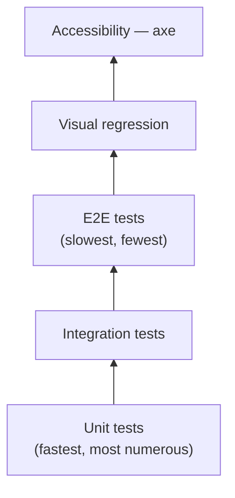
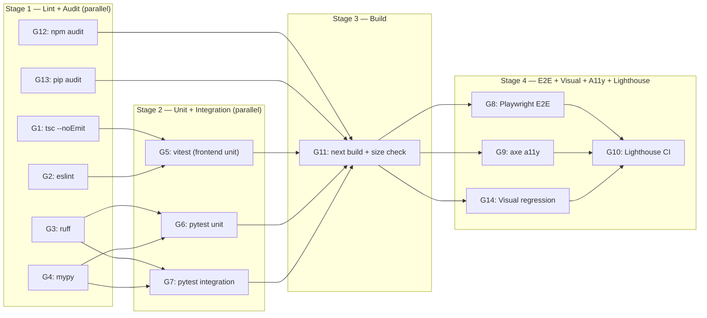

# 08 — Quality: Bug-Fix Agent

Staff QA and engineering-excellence specification. Every gate, threshold, and checklist item is concrete and enforceable — no "looks fine" allowed.

Cross-references: `01-prd.md` (features, acceptance hints), `03-app-flow.md` (journeys, state tables), `05-architecture.md` (stack, budgets), `06-data-api.md` (schema, API routes, seed data), `07-security-privacy.md` (security controls), `STANDARDS.md` (launch gates).

---

## 1 · Test strategy

### 1.1 Test pyramid



### 1.2 Layers at a glance

| Layer | Tool | Scope | When it runs | Approx count |
|-------|------|-------|-------------|--------------|
| Unit (frontend) | Vitest + React Testing Library | Components, `lib/`, utils, hooks | Every commit (CI) | ~40–60 |
| Unit (backend) | pytest | Pipeline steps, repo layer, auth helpers, Pydantic schemas | Every commit (CI) | ~30–50 |
| Integration (backend) | pytest + httpx `TestClient` | Full API route → in-memory store → response | Every commit (CI) | ~15–25 |
| E2E | Playwright (Chromium + WebKit) | Critical journeys across a real browser | Every PR (CI) | 8 |
| Visual regression | Playwright `toHaveScreenshot()` | Key pages at 3 viewport widths | Every PR (CI) | ~12–18 |
| Accessibility | axe-playwright | Every navigable route | Every PR (CI) | 16 (one per route) |
| Manual QA | Human + real phone | Touch, scroll, auth, dark mode, orientation | Pre-launch gate | 1 script (§ 9) |

### 1.3 Why these tools

| Choice | Reason | Alternative rejected |
|--------|--------|---------------------|
| **Vitest** over Jest | ESM-native, fast HMR, first-class support in the Vite / Next.js ecosystem | Jest — slower transforms, CJS-first |
| **pytest** over unittest | Fixtures, parametrise, better assertions; standard in FastAPI projects | unittest — verbose, no fixtures |
| **Playwright** over Cypress | Multi-browser (WebKit for Safari), built-in screenshot comparison, ₹0 | Cypress — no WebKit, paid dashboard for screenshots |
| **axe-playwright** over pa11y | Integrates into existing Playwright suite; same test infrastructure | pa11y — separate runner, extra config |
| **Playwright screenshots** over Chromatic/Percy | ₹0 budget; built into Playwright; no vendor dependency | Chromatic/Percy — paid services |

---

## 2 · What gets tested — what deliberately doesn't

### 2.1 Frontend unit tests (Vitest + React Testing Library)

**Tested:**

| Module | What is tested | Example assertion |
|--------|---------------|-------------------|
| `lib/session.ts` | Cookie parse, validate, expired check | `expect(parseSession(validCookie)).toEqual({ github_login: "demo" })` |
| `lib/api-client.ts` | Fetch wrapper: success, 401 redirect, 429 retry, network error | `expect(fetchRuns()).rejects.toThrow("RATE_LIMITED")` |
| `lib/sse.ts` | EventSource connect, reconnect on error, parse step events | `expect(onStep).toHaveBeenCalledWith({ step: "reproduce", status: "running" })` |
| `lib/utils.ts` | Date formatting, status→badge colour mapping, confidence label | `expect(statusColor("completed")).toBe("success")` |
| `components/status-badge.tsx` | Renders correct variant per status | `expect(screen.getByText("Completed")).toHaveClass("bg-success")` |
| `components/run-list.tsx` | Renders rows from mock data; empty state; loading skeleton | `expect(screen.getByText("No runs yet")).toBeInTheDocument()` |
| `components/sse-timeline.tsx` | Renders 6 steps in order; shows "running" indicator on active step | `expect(steps).toHaveLength(6)` |
| `components/toast.tsx` | Shows and auto-dismisses; accessible role="alert" | `expect(screen.getByRole("alert")).toHaveTextContent("Try again")` |
| `components/empty-state.tsx` | Renders message + CTA link | `expect(screen.getByRole("link")).toHaveAttribute("href", "/how-it-works")` |
| `components/nav.tsx` | Sign-in / sign-out button based on auth state; mobile hamburger toggle | `expect(screen.getByText("Sign out")).toBeVisible()` |

**Not tested (frontend unit):**

| What | Why |
|------|-----|
| Static marketing page content (H1 text, paragraph copy) | Changes too frequently to track; Lighthouse SEO and visual regression cover regressions |
| CSS layout and spacing | Covered by visual regression screenshots |
| `next/image` optimisation behaviour | Next.js internal; tested upstream |
| Third-party OAuth redirect mechanics | Mocked at the boundary; E2E covers the full flow |

### 2.2 Backend unit tests (pytest)

**Tested:**

| Module | What is tested | Example assertion |
|--------|---------------|-------------------|
| `auth/oauth.py` | `verify_state()`, `exchange_code()` (mocked HTTP), `encrypt_token()`, `decrypt_token()` | `assert decrypt_token(encrypt_token("ghp_xxx")) == "ghp_xxx"` |
| `auth/middleware.py` | `require_auth()` — valid session, expired session, missing cookie, tampered cookie | `assert response.status_code == 401` |
| `webhooks/github.py` | `verify_signature()` — valid, invalid, missing header; `deduplicate()` — new delivery, repeat delivery | `assert verify_signature(body, sig, secret) is True` |
| `pipeline/langgraph.py` | Each step function in isolation (mocked LLM, mocked Docker) — `read_issue()`, `reproduce()`, `diagnose()`, `fix()`, `verify()`, `open_pr()` | `assert step_result.status == "completed"` |
| `pipeline/sandbox.py` | `build_docker_cmd()` — flags include `--network=none`, `--user=nonroot`, `--memory`, `--cpus`; `parse_exit_code()` | `assert "--network=none" in cmd` |
| `pipeline/llm.py` | `call_llm()` with cache hit, cache miss, rate-limit retry; `hash_cache_key()` | `assert cache.get(key) == cached_response` |
| `data/run_repo.py` | CRUD: create, get, list (with ownership filter), update status, delete; pagination cursor encode/decode | `assert len(repo.list(user_a)) == 2` |
| `schemas.py` | Pydantic validation — valid input, missing fields, out-of-range `limit`, invalid `status` enum | `with pytest.raises(ValidationError)` |

**Not tested (backend unit):**

| What | Why |
|------|-----|
| Actual Docker container execution | Requires Docker daemon; tested in manual QA and a dedicated sandbox integration test |
| Actual GitHub API calls | Mocked; real calls are rate-limited and require a token |
| Actual LLM API calls | Mocked; real calls cost credits and are non-deterministic |
| JSON-file persistence (filesystem I/O) | Transient, demo-scoped; in-memory repo is the test target |

### 2.3 Backend integration tests (pytest + httpx TestClient)

**Tested:**

| Route | What is tested |
|-------|---------------|
| `POST /webhooks/github` | Valid webhook → run created; invalid signature → 401; duplicate delivery → 409; missing headers → 400 |
| `GET /runs` | Returns only caller's runs (ownership filter); pagination (limit, cursor); status filter; unauthenticated → 401 |
| `GET /runs/{run_id}` | Own run → 200 with steps; other user's run → 404 (IDOR); invalid UUID → 400; unauthenticated → 401 |
| `GET /runs/{run_id}/events` | SSE stream opens; sends step events; ownership check; unauthenticated → 401 |
| `POST /runs/{run_id}/retry` | Failed run → 200 retry queued; completed run → 409; missing Idempotency-Key → 400; wrong user → 404 |
| `GET /auth/session` | Authenticated → user info; unauthenticated → `{ authenticated: false }` |
| `POST /auth/logout` | Clears session; subsequent request → 401 |
| Rate limits | Send 61 requests in 1 minute → 429 + Retry-After header |
| Error format | Every error matches the standard `{ error: { code, message, details } }` shape |

**Not tested (integration):**

| What | Why |
|------|-----|
| Full pipeline execution (webhook → LangGraph → Docker → PR) | Too slow for CI; covered by manual QA with the seeded demo |
| Vercel deployment behaviour | Tested by Lighthouse CI against the Vercel preview URL |

### 2.4 E2E tests (Playwright) — see § 3

### 2.5 Visual regression — see § 5 CI gates

### 2.6 Accessibility — see § 5 CI gates

---

## 3 · Critical journeys — E2E tests

Each journey maps to a Playwright test file. OAuth is mocked using Playwright's route interception (no real GitHub calls).

### 3.1 Journey table

| # | Journey | Source | Playwright file | Steps verified | Key assertions |
|---|---------|--------|----------------|---------------|----------------|
| J1 | Visitor → label → draft PR | `03-app-flow.md` Journey 1 | `e2e/j1-label-to-pr.spec.ts` | Land `/` → click CTA → OAuth mock → `/dashboard` → trigger run (mocked webhook response) → see timeline → see PR link | PR link `href` matches `pr_url`; status badge = "completed"; confidence badge visible |
| J2 | Live demo flow | `03-app-flow.md` Journey 2 | `e2e/j2-demo-flow.spec.ts` | `/demo` → 3 seeded issue cards visible → click "View live runs" → `/dashboard/runs/[runId]` → SSE timeline streams 6 steps → red→green output visible | All 6 step nodes rendered in order; test output contains "FAILED → PASSED" |
| J3 | Review and approve PR | `03-app-flow.md` Journey 3 | `e2e/j3-review-pr.spec.ts` | Sign in → `/dashboard` → click run card ("PR opened") → see root-cause + confidence → click "View draft PR" | Root-cause text non-empty; confidence ∈ {high, medium, low}; PR link `href` valid |
| J4 | Sign in / sign out | `03-app-flow.md` Journey 4 | `e2e/j4-auth-flow.spec.ts` | Click "Sign in" → OAuth mock → cookie set → `/dashboard` loads → click "Sign out" → cookie cleared → redirected `/` | Cookie `__Host-session_id` present after login; absent after logout; `/dashboard` returns 302 after logout |
| J5 | Failed run recovery | `03-app-flow.md` Journey 5 | `e2e/j5-failed-recovery.spec.ts` | Trigger run → "couldn't reproduce" state → retry button visible → click retry → new run starts | Old run status unchanged; new run status = "pending" or "reproducing"; retry button disappears during active run |
| J6 | IDOR prevention (negative) | `07-security-privacy.md` § 4 | `e2e/j6-idor.spec.ts` | Sign in as user A → navigate to `/dashboard/runs/{user_b_run_id}` | Page shows 404 or "Run not found"; no run data leaked in DOM or network response |
| J7 | Unauthenticated access (negative) | `03-app-flow.md` state tables | `e2e/j7-unauth.spec.ts` | Visit `/dashboard` without session | Redirected to `/auth/github`; no dashboard content flashes |
| J8 | SSE reconnect | `03-app-flow.md` partial state | `e2e/j8-sse-reconnect.spec.ts` | Open run detail → simulate offline (`page.route` to abort SSE) → go online → SSE reconnects | Timeline resumes; no duplicate steps; reconnect indicator shown then hidden |

### 3.2 Playwright config highlights

```typescript
// playwright.config.ts

import { defineConfig, devices } from "@playwright/test";

export default defineConfig({
  testDir: "./e2e",
  timeout: 30_000,
  retries: 1,
  workers: 2,
  reporter: [["html"], ["github"]],
  use: {
    baseURL: process.env.BASE_URL || "http://localhost:3000",
    trace: "on-first-retry",
    screenshot: "only-on-failure",
  },
  projects: [
    { name: "chromium", use: { ...devices["Desktop Chrome"] } },
    { name: "webkit",   use: { ...devices["Desktop Safari"] } },
  ],
});
```

### 3.3 OAuth mock pattern

```typescript
// e2e/helpers/mock-oauth.ts

import { Page } from "@playwright/test";

/**
 * Intercept the GitHub OAuth flow so E2E tests never hit real GitHub.
 * 1. Intercept /auth/github → redirect to /auth/callback?code=mock&state=mock
 * 2. Intercept the backend token exchange → return a mock access token
 * 3. The backend sets the session cookie normally.
 */
export async function mockOAuth(page: Page) {
  // Intercept the redirect to GitHub
  await page.route("**/auth/github", (route) => {
    route.fulfill({
      status: 302,
      headers: {
        Location: "/auth/callback?code=mock_code&state=mock_state",
      },
    });
  });

  // Intercept the backend's token exchange with GitHub
  await page.route("**/github.com/login/oauth/access_token", (route) => {
    route.fulfill({
      status: 200,
      contentType: "application/json",
      body: JSON.stringify({
        access_token: "gho_mock_token_for_testing",
        token_type: "bearer",
        scope: "repo",
      }),
    });
  });
}
```

### 3.4 Journey example — J4 Sign in / sign out

```typescript
// e2e/j4-auth-flow.spec.ts

import { test, expect } from "@playwright/test";
import { mockOAuth } from "./helpers/mock-oauth";

test.describe("J4 — Sign in / sign out", () => {
  test("full auth lifecycle", async ({ page, context }) => {
    await mockOAuth(page);

    // 1. Visit home, click sign-in
    await page.goto("/");
    await page.getByRole("link", { name: /sign in with github/i }).click();

    // 2. Should land on /dashboard after OAuth mock
    await expect(page).toHaveURL(/\/dashboard/);

    // 3. Session cookie should be set
    const cookies = await context.cookies();
    const session = cookies.find((c) => c.name.includes("session_id"));
    expect(session).toBeDefined();
    expect(session!.httpOnly).toBe(true);
    expect(session!.secure).toBe(true);
    expect(session!.sameSite).toBe("Lax");

    // 4. Dashboard should show signed-in state
    await expect(page.getByText(/sign out/i)).toBeVisible();

    // 5. Sign out
    await page.getByRole("button", { name: /sign out/i }).click();

    // 6. Should redirect to /
    await expect(page).toHaveURL("/");

    // 7. Session cookie should be cleared
    const postLogoutCookies = await context.cookies();
    const gone = postLogoutCookies.find((c) => c.name.includes("session_id"));
    expect(gone).toBeUndefined();

    // 8. Visiting /dashboard should redirect to auth
    await page.goto("/dashboard");
    await expect(page).toHaveURL(/\/auth\/github/);
  });
});
```

---

## 4 · Test data and fixtures

### 4.1 Fixture inventory

| Fixture file | Format | Used by | Contents |
|-------------|--------|---------|----------|
| `tests/fixtures/seeded-runs.json` | JSON | Backend integration, E2E | 3 runs from `06-data-api.md` seed data: off-by-one (completed, high), wrong condition (completed, medium), missing null check (failed) |
| `tests/fixtures/seeded-steps.json` | JSON | Backend integration, E2E | 18 step rows: 6 per completed run (read → reproduce → diagnose → fix → verify → pr), 3 for the failed run (read → reproduce → diagnose, diagnose = failed) |
| `tests/fixtures/mock-webhook-labeled.json` | JSON | Backend integration | Valid `issues.labeled` webhook payload with `action: "labeled"`, `label.name: "agent-fix"`, correct repo/issue fields |
| `tests/fixtures/mock-webhook-signature.py` | Python | Backend integration | Helper that computes `X-Hub-Signature-256` for a given payload + secret |
| `tests/fixtures/mock-oauth-response.json` | JSON | E2E (Playwright route mock) | `{ access_token, token_type, scope }` + user profile `{ id, login }` |
| `tests/fixtures/mock-session.json` | JSON | Frontend unit (Vitest) | `{ authenticated: true, github_login: "demo-user", github_user_id: 12345 }` |
| `tests/fixtures/mock-sse-events.txt` | Text (SSE format) | Frontend unit (SSE parser) | Raw SSE stream: `event: step_updated\ndata: {...}\n\n` for all 6 steps |
| `e2e/storage-state.json` | JSON | Playwright (`storageState`) | Pre-authenticated browser state (session cookie set) — generated by a setup project |

### 4.2 Run factory (backend)

```python
# tests/factories.py

from uuid import uuid4
from datetime import datetime, timezone

def make_run(**overrides) -> dict:
    """Create a run dict with sensible defaults. Override any field."""
    now = datetime.now(timezone.utc).isoformat()
    return {
        "id": str(uuid4()),
        "installation_id": 1,
        "repository_full_name": "fixie-demo/seeded-repo",
        "issue_number": 1,
        "issue_title": "Off-by-one in calculate_discount",
        "issue_body": "When quantity is 10, discount is calculated as 10% instead of 15%.",
        "status": "completed",
        "confidence": "high",
        "pr_url": "https://github.com/fixie-demo/seeded-repo/pull/1",
        "pr_number": 1,
        "test_output": "FAILED test_off_by_one → PASSED test_off_by_one",
        "root_cause": "Loop boundary used < instead of <= at line 42.",
        "repo_language": "python",
        "triggered_by": "demo-user",
        "created_at": now,
        "updated_at": now,
        "completed_at": now,
        **overrides,
    }


def make_step(run_id: str, step: str = "read", **overrides) -> dict:
    """Create a run_step dict."""
    now = datetime.now(timezone.utc).isoformat()
    return {
        "id": str(uuid4()),
        "run_id": run_id,
        "step": step,
        "status": "completed",
        "started_at": now,
        "completed_at": now,
        "output": f"Step {step} completed.",
        "error": None,
        "created_at": now,
        "updated_at": now,
        **overrides,
    }


def make_seeded_runs() -> list[dict]:
    """Return the 3 seeded demo runs matching 06-data-api.md seed data."""
    return [
        make_run(
            issue_number=1,
            issue_title="Off-by-one in calculate_discount",
            status="completed",
            confidence="high",
        ),
        make_run(
            issue_number=2,
            issue_title="Wrong condition in validate_age",
            status="completed",
            confidence="medium",
        ),
        make_run(
            issue_number=3,
            issue_title="Missing null check in get_user_profile",
            status="failed",
            confidence=None,
            pr_url=None,
            pr_number=None,
            test_output=None,
            root_cause="Agent could not reproduce: no steps to reproduce provided.",
        ),
    ]
```

### 4.3 Component fixture (frontend)

```typescript
// tests/fixtures/mock-session.ts

export const authenticatedSession = {
  authenticated: true,
  github_login: "demo-user",
  github_user_id: 12345,
};

export const unauthenticatedSession = {
  authenticated: false,
};
```

```typescript
// tests/fixtures/mock-runs.ts

import type { Run } from "@/types";

export const completedRun: Run = {
  id: "aaaaaaaa-bbbb-4ccc-dddd-eeeeeeeeeeee",
  repository_full_name: "fixie-demo/seeded-repo",
  issue_number: 1,
  issue_title: "Off-by-one in calculate_discount",
  status: "completed",
  confidence: "high",
  pr_url: "https://github.com/fixie-demo/seeded-repo/pull/1",
  created_at: "2026-11-10T08:00:00Z",
  completed_at: "2026-11-10T08:02:00Z",
};

export const failedRun: Run = {
  id: "ffffffff-gggg-4hhh-iiii-jjjjjjjjjjjj",
  repository_full_name: "fixie-demo/seeded-repo",
  issue_number: 3,
  issue_title: "Missing null check in get_user_profile",
  status: "failed",
  confidence: null,
  pr_url: null,
  created_at: "2026-11-10T08:04:00Z",
  completed_at: "2026-11-10T08:05:00Z",
};

export const emptyRunList: Run[] = [];
```

### 4.4 Fixture rules

1. **No real tokens.** All mock tokens use the pattern `gho_mock_*` or `ghp_test_*` — never a real GitHub token.
2. **Deterministic IDs.** Seeded run UUIDs are hardcoded for cross-test consistency. Factory-generated runs use `uuid4()`.
3. **No network.** Fixtures are local JSON/TS files. No test hits a real API.
4. **Seed data alignment.** The 3 seeded runs match `06-data-api.md` exactly — same issue titles, statuses, and confidence values.

---

## 5 · CI gates — exact thresholds

Every CI gate has a tool, exact command, hard threshold, and merge-blocking status.

### 5.1 Gate table

| # | Gate | Tool | Command | Threshold | Blocks merge? |
|---|------|------|---------|-----------|:---:|
| G1 | TypeScript types | `tsc` | `npx tsc --noEmit` | Zero errors | ✅ |
| G2 | ESLint (frontend) | `eslint` | `npx eslint . --max-warnings=0` | Zero errors, zero warnings | ✅ |
| G3 | Python lint | `ruff` | `ruff check apps/api/` | Zero errors | ✅ |
| G4 | Python types | `mypy` | `mypy --strict apps/api/` | Zero errors | ✅ |
| G5 | Frontend unit tests | Vitest | `npx vitest run --reporter=verbose` | All pass | ✅ |
| G6 | Backend unit tests | pytest | `pytest tests/unit/ -v` | All pass | ✅ |
| G7 | Backend integration tests | pytest + httpx | `pytest tests/integration/ -v` | All pass | ✅ |
| G8 | E2E tests | Playwright | `npx playwright test --reporter=html` | All pass (Chromium + WebKit) | ✅ |
| G9 | Accessibility (axe) | axe-playwright | `npx playwright test e2e/a11y/` | Zero serious or critical violations | ✅ |
| G10 | Lighthouse CI | LHCI | `npx lhci autorun` | See § 5.2 | ✅ |
| G11 | Bundle size | `next build` | `npx next build` + size script | See § 5.3 | ✅ |
| G12 | Dependency audit (Node) | `npm audit` | `npm audit --audit-level=high` | Zero high / critical | ✅ |
| G13 | Dependency audit (Python) | `pip audit` | `pip audit --strict --desc` | Zero high / critical | ✅ |
| G14 | Visual regression | Playwright screenshots | `npx playwright test e2e/visual/` | All screenshots match baseline | ⚠️ Warning (manual approval to update baselines) |

### 5.2 Lighthouse CI thresholds

Tested against 4 representative routes on the Vercel preview deployment:

| Route | Performance | Accessibility | Best Practices | SEO |
|-------|:-----------:|:------------:|:--------------:|:---:|
| `/` | ≥ 90 | ≥ 95 | ≥ 90 | ≥ 95 |
| `/how-it-works` | ≥ 90 | ≥ 95 | ≥ 90 | ≥ 95 |
| `/dashboard` | ≥ 85 | ≥ 95 | ≥ 90 | ≥ 90 |
| `/dashboard/runs/[runId]` | ≥ 85 | ≥ 95 | ≥ 90 | ≥ 90 |

Dashboard routes allow ≥ 85 performance (SSR + SSE adds overhead vs static marketing pages).

```javascript
// lighthouserc.js

module.exports = {
  ci: {
    collect: {
      url: [
        process.env.PREVIEW_URL + "/",
        process.env.PREVIEW_URL + "/how-it-works",
        // Dashboard routes need authenticated state — use LHCI puppeteerScript
      ],
      numberOfRuns: 3,
    },
    assert: {
      assertions: {
        "categories:performance":   ["error", { minScore: 0.85 }],
        "categories:accessibility": ["error", { minScore: 0.95 }],
        "categories:best-practices":["error", { minScore: 0.90 }],
        "categories:seo":           ["error", { minScore: 0.90 }],
      },
    },
    upload: {
      target: "temporary-public-storage",
    },
  },
};
```

### 5.3 Bundle-size budgets

From `05-architecture.md` performance budgets:

| Route group | Max initial JS | Enforcement |
|-------------|:-------------:|-------------|
| Marketing (`/`, `/how-it-works`, `/demo`, `/security`, `/pricing`, `/about`, `/changelog`) | **40 KB** | CI script parses `next build` output |
| Dashboard (`/dashboard`, `/dashboard/runs/[runId]`) | **100 KB** | CI script parses `next build` output |
| Error pages (`/404`, `/500`, `/maintenance`) | **30 KB** | CI script parses `next build` output |

```bash
#!/bin/bash
# scripts/check-bundle-size.sh
# Run after `next build`. Exits non-zero if any route exceeds budget.

set -euo pipefail

BUILD_DIR=".next"
MARKETING_MAX_KB=40
DASHBOARD_MAX_KB=100
ERROR_MAX_KB=30

check_route() {
  local route="$1" max_kb="$2"
  # next build outputs "First Load JS" per route in the build summary
  local size_kb
  size_kb=$(grep "$route" "$BUILD_DIR/build-manifest.json" \
    | node -e "/* parse and sum JS chunk sizes */" 2>/dev/null || echo "0")

  if (( size_kb > max_kb )); then
    echo "FAIL: $route is ${size_kb}KB (budget: ${max_kb}KB)"
    return 1
  fi
  echo "PASS: $route is ${size_kb}KB (budget: ${max_kb}KB)"
}

# Marketing routes
for route in "/" "/how-it-works" "/demo" "/security" "/pricing" "/about" "/changelog"; do
  check_route "$route" "$MARKETING_MAX_KB"
done

# Dashboard routes
for route in "/dashboard" "/dashboard/runs/\\[runId\\]"; do
  check_route "$route" "$DASHBOARD_MAX_KB"
done

# Error pages
for route in "/404" "/500" "/maintenance"; do
  check_route "$route" "$ERROR_MAX_KB"
done

echo "All bundle-size checks passed."
```

### 5.4 CI pipeline flow



### 5.5 GitHub Actions workflow (skeleton)

```yaml
# .github/workflows/ci.yml

name: CI
on:
  pull_request:
    branches: [main]
  push:
    branches: [main]

jobs:
  lint:
    runs-on: ubuntu-latest
    strategy:
      matrix:
        check:
          - { name: "tsc",    cmd: "npx tsc --noEmit" }
          - { name: "eslint", cmd: "npx eslint . --max-warnings=0" }
          - { name: "ruff",   cmd: "ruff check apps/api/" }
          - { name: "mypy",   cmd: "mypy --strict apps/api/" }
          - { name: "npm-audit", cmd: "npm audit --audit-level=high" }
          - { name: "pip-audit", cmd: "pip audit --strict --desc" }
    steps:
      - uses: actions/checkout@v4
      - uses: actions/setup-node@v4
        with: { node-version: 20 }
      - uses: actions/setup-python@v5
        with: { python-version: "3.12" }
      - run: npm ci
      - run: pip install -r requirements.txt
      - run: ${{ matrix.check.cmd }}

  test:
    needs: lint
    runs-on: ubuntu-latest
    strategy:
      matrix:
        suite:
          - { name: "vitest",         cmd: "npx vitest run --reporter=verbose" }
          - { name: "pytest-unit",    cmd: "pytest tests/unit/ -v" }
          - { name: "pytest-integ",   cmd: "pytest tests/integration/ -v" }
    steps:
      - uses: actions/checkout@v4
      - uses: actions/setup-node@v4
        with: { node-version: 20 }
      - uses: actions/setup-python@v5
        with: { python-version: "3.12" }
      - run: npm ci
      - run: pip install -r requirements.txt
      - run: ${{ matrix.suite.cmd }}

  build:
    needs: test
    runs-on: ubuntu-latest
    steps:
      - uses: actions/checkout@v4
      - uses: actions/setup-node@v4
        with: { node-version: 20 }
      - run: npm ci
      - run: npx next build
      - run: bash scripts/check-bundle-size.sh

  e2e:
    needs: build
    runs-on: ubuntu-latest
    steps:
      - uses: actions/checkout@v4
      - uses: actions/setup-node@v4
        with: { node-version: 20 }
      - run: npm ci
      - run: npx playwright install --with-deps chromium webkit
      - run: npx playwright test --reporter=html
      - uses: actions/upload-artifact@v4
        if: always()
        with:
          name: playwright-report
          path: playwright-report/

  lighthouse:
    needs: e2e
    runs-on: ubuntu-latest
    steps:
      - uses: actions/checkout@v4
      - uses: actions/setup-node@v4
        with: { node-version: 20 }
      - run: npm ci
      - run: npm install -g @lhci/cli
      - run: lhci autorun
        env:
          PREVIEW_URL: ${{ steps.deploy.outputs.url }}
```

---

## 6 · Code-review checklist

Every PR requires at least one approving review. Reviewers must confirm each applicable section before approving.

### Correctness

- [ ] Change does what the ticket describes.
- [ ] Edge cases handled: empty, null, zero, max-length, error, offline.
- [ ] No regressions — existing tests still pass.
- [ ] State transitions are valid (e.g., only `failed` / `could_not_reproduce` → retry).
- [ ] API responses match the contract in `06-data-api.md`.

### Security (cross-ref `07-security-privacy.md`)

- [ ] No secrets in client code, logs, or error messages.
- [ ] User input validated server-side (Pydantic model or explicit check).
- [ ] Output encoded — no `dangerouslySetInnerHTML`, no `eval()`, no `shell=True`.
- [ ] Ownership check on every data access (installation_id + triggered_by).
- [ ] Rate-limit decorator on new endpoints.
- [ ] No new `NEXT_PUBLIC_*` env vars containing secrets.

### Performance (cross-ref `05-architecture.md` budgets)

- [ ] No new third-party scripts or external font requests.
- [ ] Images use `next/image` with AVIF/WebP, sized, lazy below fold.
- [ ] No synchronous blocking calls on the render path.
- [ ] Bundle size within budget (marketing ≤ 40 KB, dashboard ≤ 100 KB).
- [ ] No `useEffect` waterfalls — data fetched in server components or parallel.

### Accessibility (cross-ref `STANDARDS.md`)

- [ ] New interactive elements are keyboard-accessible (Tab, Enter, Escape).
- [ ] Focus ring visible and not obscured by sticky UI.
- [ ] Semantic HTML: headings in order, `<button>` not `<div onClick>`, `<a>` for navigation.
- [ ] Labels on inputs; alt text on images; ARIA only where HTML semantics are insufficient.
- [ ] Contrast ≥ 4.5:1 text, ≥ 3:1 large text and UI components.
- [ ] `prefers-reduced-motion` respected for animations.

### Code quality

- [ ] TypeScript strict — no untyped `any` without a justifying comment.
- [ ] No `TODO`, `FIXME`, or `console.log` on critical paths.
- [ ] Tests added or updated for changed logic.
- [ ] Commit messages follow Conventional Commits (`feat:`, `fix:`, `test:`, `docs:`, `chore:`).
- [ ] No duplicated logic — extracted into `lib/` or shared utility.

### UX (cross-ref `03-app-flow.md` state tables)

- [ ] Every affected page state (loading, empty, error, success, partial, offline) has microcopy.
- [ ] Responsive at 360 px — no horizontal scroll, tap targets ≥ 44 px.
- [ ] Dark mode parity — colours from design tokens, not hardcoded.
- [ ] Optimistic UI where safe (button disabled immediately on click).
- [ ] Error messages are human-readable — no raw error codes or stack traces.

---

## 7 · Definition of Done

A ticket moves to "Done" only when **all** of the following are true. No exceptions.

| # | Criterion | How verified |
|---|-----------|-------------|
| D1 | **Code complete** — implementation matches the ticket's acceptance criteria | Self-check by author |
| D2 | **CI green** — all 14 gates pass (§ 5) | GitHub Actions status checks |
| D3 | **New tests written** — changed logic has unit tests; changed journeys have E2E coverage | Reviewer confirms in checklist |
| D4 | **Accessibility clean** — axe scan zero serious/critical on affected routes | G9 gate in CI |
| D5 | **Types + lint clean** — `tsc`, `eslint`, `ruff`, `mypy` all zero errors | G1–G4 gates in CI |
| D6 | **Code reviewed** — at least 1 approval using the full checklist (§ 6) | GitHub PR approval |
| D7 | **No open threads** — all PR review comments resolved or explicitly deferred (with linked ticket) | GitHub PR conversation |
| D8 | **Documentation updated** — API contract, route, or security control changes reflected in docs | Reviewer confirms |
| D9 | **Deployed to preview** — Vercel preview URL works; Lighthouse CI passes | G10 gate in CI |
| D10 | **Manual QA** (if UI change) — tested on at least one real phone per § 9 | QA sign-off comment on PR |

```mermaid
flowchart LR
    CODE["D1: Code complete"] --> CI["D2: CI green"]
    CI --> TESTS["D3: Tests written"]
    TESTS --> A11Y["D4: axe clean"]
    A11Y --> LINT["D5: Types + lint"]
    LINT --> REVIEW["D6: Code reviewed"]
    REVIEW --> THREADS["D7: Threads resolved"]
    THREADS --> DOCS["D8: Docs updated"]
    DOCS --> PREVIEW["D9: Preview deployed"]
    PREVIEW --> QA["D10: Manual QA"]
    QA --> DONE["✅ Done"]
```



### 7.1 What "Done" is NOT

- "It works on my machine" — must pass CI and preview deploy.
- "Tests pass locally" — must pass in CI with the exact gate thresholds.
- "I'll write tests later" — test debt is not allowed on critical paths.
- "Reviewed but threads open" — unresolved threads block merge.

---

## 8 · Visual regression tests

### 8.1 Strategy

Playwright's built-in `toHaveScreenshot()` captures and diffs screenshots against checked-in baselines. No paid service required.

### 8.2 Pages and viewports

| Page | 360 px (mobile) | 768 px (tablet) | 1280 px (desktop) | Dark mode |
|------|:---:|:---:|:---:|:---:|
| `/` | ✅ | ✅ | ✅ | ✅ (desktop only) |
| `/how-it-works` | ✅ | — | ✅ | — |
| `/demo` | ✅ | — | ✅ | — |
| `/security` | ✅ | — | ✅ | — |
| `/dashboard` (empty state) | ✅ | — | ✅ | ✅ |
| `/dashboard` (with runs) | ✅ | — | ✅ | ✅ |
| `/dashboard/runs/[runId]` (completed) | ✅ | — | ✅ | ✅ |
| `/dashboard/runs/[runId]` (failed) | ✅ | — | ✅ | — |
| `/404` | ✅ | — | ✅ | — |

### 8.3 Example test

```typescript
// e2e/visual/home.spec.ts

import { test, expect } from "@playwright/test";

const viewports = [
  { name: "mobile",  width: 360,  height: 800 },
  { name: "desktop", width: 1280, height: 900 },
];

for (const vp of viewports) {
  test(`Home — ${vp.name}`, async ({ page }) => {
    await page.setViewportSize({ width: vp.width, height: vp.height });
    await page.goto("/");
    await expect(page).toHaveScreenshot(`home-${vp.name}.png`, {
      fullPage: true,
      maxDiffPixelRatio: 0.01,
    });
  });
}
```

### 8.4 Baseline update process

1. Developer runs `npx playwright test --update-snapshots` locally.
2. New baselines are committed to `e2e/visual/*.png`.
3. PR diff shows the before/after images for reviewer inspection.
4. Reviewer approves the visual change explicitly.

---

## 9 · Manual QA script — real phones

This script is the pre-launch gate. Execute on **one Android phone (Chrome)** and **one iOS device (Safari)**. Record pass/fail per step.

### 9.1 Setup

| Step | Action | Expected |
|------|--------|----------|
| S1 | Clear browser cache and cookies | Clean state |
| S2 | Disable password manager / autofill | No interference with OAuth flow |
| S3 | Set device to **portrait** orientation | Default view |
| S4 | Connect to WiFi (not cellular — for consistency) | Stable connection |

### 9.2 Marketing pages

| # | Action | Expected | Pass? |
|---|--------|----------|:-----:|
| M1 | Open `/` in mobile browser | Hero loads within 3s; H1 and 2 CTAs visible; no horizontal scroll | ☐ |
| M2 | Scroll to bottom of `/` | Footer visible; all links tappable; no content cutoff | ☐ |
| M3 | Tap each nav link: How it works, Demo, Security, Pricing, About, Changelog | Each page loads; nav stays functional; back button works | ☐ |
| M4 | Tap Privacy and Terms links in footer | Pages load; text is readable (font size ≥ 16 px) | ☐ |
| M5 | Toggle dark mode (device setting) | All pages switch to dark palette; text/bg contrast maintained; no white flashes | ☐ |
| M6 | Rotate to landscape | Layout adapts; no overflow; CTAs still visible | ☐ |
| M7 | Check tap targets | All buttons and links ≥ 44 × 44 px touch area | ☐ |

### 9.3 Auth flow

| # | Action | Expected | Pass? |
|---|--------|----------|:-----:|
| A1 | Tap "Sign in with GitHub" on `/` | Redirect to GitHub OAuth consent screen | ☐ |
| A2 | Grant consent on GitHub | Redirect to `/dashboard`; signed-in state visible (username, sign-out button) | ☐ |
| A3 | Close browser tab, re-open `/dashboard` | Still signed in (session cookie persists) | ☐ |
| A4 | Tap "Sign out" | Redirect to `/`; sign-in button visible; `/dashboard` requires re-auth | ☐ |

### 9.4 Dashboard

| # | Action | Expected | Pass? |
|---|--------|----------|:-----:|
| D1 | Open `/dashboard` (signed in) | Run list loads; 3 seeded runs visible; status badges coloured correctly | ☐ |
| D2 | Scroll the run list | Smooth scroll; no janky repaints; pull-to-refresh does not interfere | ☐ |
| D3 | Tap a completed run card | `/dashboard/runs/[runId]` loads; 6-step timeline visible | ☐ |
| D4 | Verify red→green output is readable | `FAILED → PASSED` text in `<pre>` block; horizontally scrollable if needed; no truncation | ☐ |
| D5 | Tap "View draft PR" link | Opens GitHub PR page in browser / GitHub app | ☐ |
| D6 | Tap back to `/dashboard` | Run list intact; no flash of empty state | ☐ |
| D7 | Tap a failed run card | "Couldn't reproduce" message visible; retry button visible | ☐ |
| D8 | Tap "Retry" on failed run | Button shows loading/disabled state; new run appears (or mock confirmation) | ☐ |

### 9.5 SSE live timeline

| # | Action | Expected | Pass? |
|---|--------|----------|:-----:|
| SSE1 | Open a run in "reproducing" state | Timeline animates: steps appear one by one; "running" indicator pulses | ☐ |
| SSE2 | Toggle airplane mode for 5s, then re-enable | "Reconnecting…" indicator appears; timeline resumes without duplicates | ☐ |

### 9.6 Error states

| # | Action | Expected | Pass? |
|---|--------|----------|:-----:|
| E1 | Navigate to a non-existent URL (e.g., `/foobar`) | 404 page: "Page not found" + "Go home" button; no stack trace | ☐ |
| E2 | Visit `/dashboard` without signing in | Redirected to `/auth/github`; no dashboard content flashes | ☐ |
| E3 | Enable airplane mode, try to load `/dashboard` | Offline message or browser's offline page; no crash | ☐ |

### 9.7 Accessibility spot-checks (mobile)

| # | Action | Expected | Pass? |
|---|--------|----------|:-----:|
| AX1 | **iOS**: Enable VoiceOver; navigate `/` using swipe gestures | H1 read aloud; CTAs announced as buttons/links; skip to content works | ☐ |
| AX2 | **Android**: Enable TalkBack; navigate `/dashboard` | Run list items announced with title + status; tap targets focusable | ☐ |
| AX3 | Increase system font size to maximum | Text scales; no overflow or clipping; buttons remain tappable | ☐ |
| AX4 | Check focus ring on external keyboard (if available) | Focus ring visible on every interactive element; never hidden behind sticky nav | ☐ |

### 9.8 Sign-off

| Device | OS | Browser | Tester | Date | Pass/Fail | Notes |
|--------|----|---------| -------|------|-----------|-------|
| | | | | | | |
| | | | | | | |

Tester signs off by filling the row and commenting on the PR.

---

## Appendix A · Accessibility route scan (axe-playwright)

One test per navigable route. Runs in the E2E suite (G9).

```typescript
// e2e/a11y/scan-all-routes.spec.ts

import { test, expect } from "@playwright/test";
import AxeBuilder from "@axe-core/playwright";

const routes = [
  "/",
  "/how-it-works",
  "/demo",
  "/security",
  "/pricing",
  "/about",
  "/changelog",
  "/privacy",
  "/terms",
  "/404",
  "/500",
  "/maintenance",
];

const authRoutes = [
  "/dashboard",
  "/dashboard/runs/aaaaaaaa-bbbb-4ccc-dddd-eeeeeeeeeeee",
];

test.describe("Accessibility — public routes", () => {
  for (const route of routes) {
    test(`axe scan: ${route}`, async ({ page }) => {
      await page.goto(route);
      const results = await new AxeBuilder({ page })
        .withTags(["wcag2a", "wcag2aa", "wcag22aa"])
        .analyze();

      const serious = results.violations.filter(
        (v) => v.impact === "serious" || v.impact === "critical"
      );
      expect(serious).toHaveLength(0);
    });
  }
});

test.describe("Accessibility — authenticated routes", () => {
  test.use({ storageState: "e2e/storage-state.json" });

  for (const route of authRoutes) {
    test(`axe scan: ${route}`, async ({ page }) => {
      await page.goto(route);
      const results = await new AxeBuilder({ page })
        .withTags(["wcag2a", "wcag2aa", "wcag22aa"])
        .analyze();

      const serious = results.violations.filter(
        (v) => v.impact === "serious" || v.impact === "critical"
      );
      expect(serious).toHaveLength(0);
    });
  }
});
```

---

## Appendix B · Test directory structure

```
bug-fix-agent/
├── tests/
│   ├── unit/                           # Backend unit tests (pytest)
│   │   ├── test_auth.py
│   │   ├── test_webhook.py
│   │   ├── test_pipeline_steps.py
│   │   ├── test_sandbox.py
│   │   ├── test_llm_cache.py
│   │   ├── test_run_repo.py
│   │   └── test_schemas.py
│   ├── integration/                    # Backend integration tests (pytest + httpx)
│   │   ├── test_api_runs.py
│   │   ├── test_api_auth.py
│   │   ├── test_api_webhooks.py
│   │   ├── test_api_rate_limits.py
│   │   └── test_api_errors.py
│   ├── fixtures/                       # Shared test data
│   │   ├── seeded-runs.json
│   │   ├── seeded-steps.json
│   │   ├── mock-webhook-labeled.json
│   │   ├── mock-webhook-signature.py
│   │   ├── mock-oauth-response.json
│   │   └── mock-sse-events.txt
│   └── factories.py                    # Run/step factory helpers
├── apps/web/
│   └── __tests__/                      # Frontend unit tests (Vitest)
│       ├── lib/
│       │   ├── session.test.ts
│       │   ├── api-client.test.ts
│       │   ├── sse.test.ts
│       │   └── utils.test.ts
│       ├── components/
│       │   ├── status-badge.test.tsx
│       │   ├── run-list.test.tsx
│       │   ├── sse-timeline.test.tsx
│       │   ├── toast.test.tsx
│       │   ├── empty-state.test.tsx
│       │   └── nav.test.tsx
│       └── fixtures/
│           ├── mock-session.ts
│           ├── mock-runs.ts
│           └── mock-sse-events.ts
├── e2e/                                # E2E + visual + a11y (Playwright)
│   ├── j1-label-to-pr.spec.ts
│   ├── j2-demo-flow.spec.ts
│   ├── j3-review-pr.spec.ts
│   ├── j4-auth-flow.spec.ts
│   ├── j5-failed-recovery.spec.ts
│   ├── j6-idor.spec.ts
│   ├── j7-unauth.spec.ts
│   ├── j8-sse-reconnect.spec.ts
│   ├── visual/
│   │   ├── home.spec.ts
│   │   ├── dashboard.spec.ts
│   │   ├── run-detail.spec.ts
│   │   └── error-pages.spec.ts
│   ├── a11y/
│   │   └── scan-all-routes.spec.ts
│   ├── helpers/
│   │   └── mock-oauth.ts
│   └── storage-state.json
├── scripts/
│   └── check-bundle-size.sh
├── playwright.config.ts
├── lighthouserc.js
└── vitest.config.ts
```
